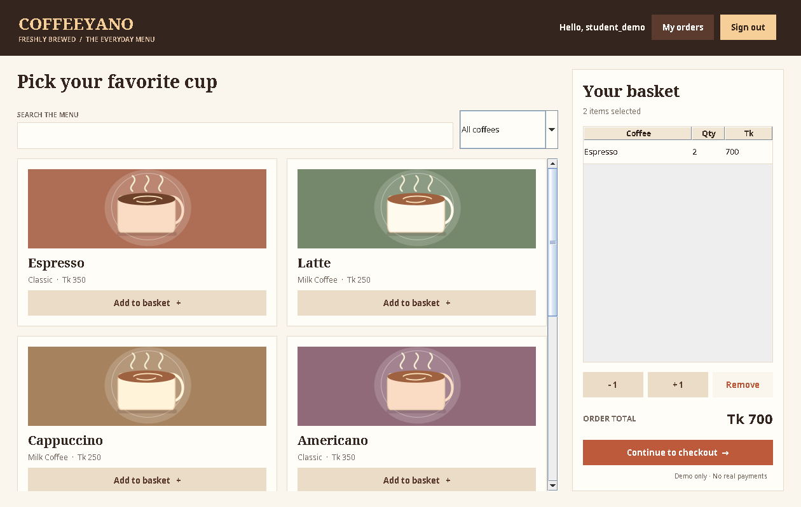
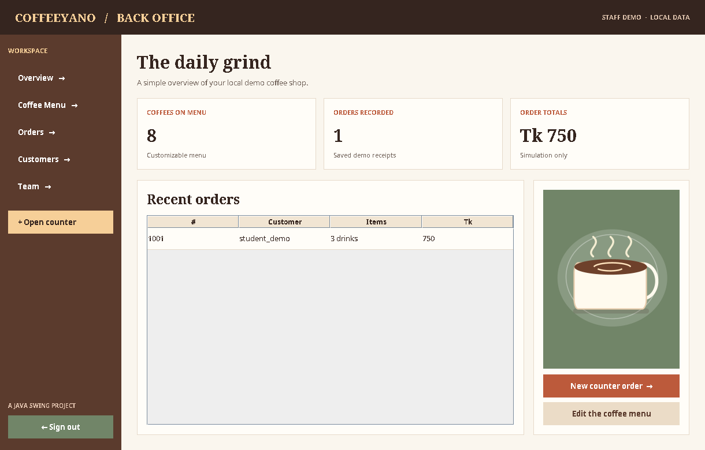

# CoffeeYano — Coffee Shop Management System

A small Java Swing coffee shop application developed from my university Java coursework project. It has two views: customers can browse drinks and place **demo orders**, while staff can maintain the menu and review saved records.

No web framework, database server, or additional library is required.

## Preview

| Customer menu | Staff dashboard |
| --- | --- |
|  |  |

More screenshots: [Login](docs/login.png) · [Menu editor](docs/management.png) · [Checkout dialog](docs/checkout.png)

## Features

**Customer side**
- Create a local account and sign in, or browse as a guest.
- Search and filter the coffee menu by category.
- Add drinks to the basket, adjust quantities, and see the total.
- Confirm a simulated checkout and view a printable receipt.
- View past demo orders while signed into a registered account.

**Staff side**
- View simple order totals and recent orders.
- Add, update, remove, or temporarily hide menu items.
- Search past orders and open their receipts.
- View registered customer usernames (never passwords).
- Maintain a small employee name/role list.
- Open the ordering screen as a counter sale.

The starting menu contains eight coffees and keeps the prices from the original project.

## Run locally

Requirements: **JDK 8 or newer** and a desktop environment that supports Java Swing.

Open a terminal in the `CoffeeYano` folder:

```bash
javac -encoding UTF-8 -d out src/*.java
java -cp out Start
```

On Windows, you can use the same commands in PowerShell or Command Prompt. If your terminal does not expand `src/*.java`, compile the source files through your Java IDE instead (for example IntelliJ IDEA, Eclipse, or NetBeans).

If you downloaded the separate executable JAR, run it with:

```bash
java -jar CoffeeYano_Java_App.jar
```

**Getting started:** On the login screen, select **Browse as guest**, register a local demo account, or open **Staff demo**. Staff demo access has no authentication and is intended only for coursework demonstrations.

## Project files

```text
CoffeeYano/
├── src/
│   ├── Start.java
│   ├── CoffeeShopLoginPage.java
│   ├── RegistrationFrame.java
│   ├── CoffeeShopCustomerPanel.java
│   ├── CoffeeShopAdminDashboard.java
│   ├── PaymentGatewayGUI.java
│   ├── ReceiptFrame.java
│   ├── CoffeeItem.java
│   ├── CoffeeOrder.java
│   ├── CoffeeShopData.java
│   ├── CafeStyle.java
│   └── CoffeeArt.java
├── tests/
│   ├── CoffeeShopTests.java
│   ├── CheckoutSmokeTest.java
│   └── PreviewCapture.java
├── docs/
│   ├── login.png
│   ├── menu.png
│   ├── dashboard.png
│   ├── management.png
│   └── checkout.png
├── README.md
├── CHANGES.md
└── GITHUB_SETUP.md
```

The interface uses Java Swing/AWT. Illustrations are drawn with Java2D inside `CoffeeArt.java`, rather than relying on external images.

## Local data

The application keeps its own files in:

- **Windows:** `C:\Users\<your-account>\.coffeeyano`
- **Linux / macOS:** `~/.coffeeyano`

Files created there include `menu.txt`, `accounts.txt`, `orders.txt`, and `team.txt`. These are **not** included in the repository. The `accounts.txt` file stores salted PBKDF2 password hashes rather than plaintext passwords.

The original archive contained `user_data.txt` with plaintext credentials. It is intentionally **not bundled or imported** into this version. Create fresh local demo accounts to test sign-in.

## Important limitations

This is an **educational demonstration**, not a deployed café service. It does **not** process payments. “Cash on pickup,” “Pay at counter,” and “Card demo” are only labels for local order records; do not enter financial details. The staff view is intentionally unlocked for demonstrations, so it must not be used with real business or customer information. All records are stored locally, without multi-user synchronization.

## Test

```bash
javac -encoding UTF-8 -d out src/*.java tests/CoffeeShopTests.java
java -cp out CoffeeShopTests
```

The tests create temporary data outside the project. GUI checks require a display. See [CHANGES.md](CHANGES.md) for the changes from the original version.
